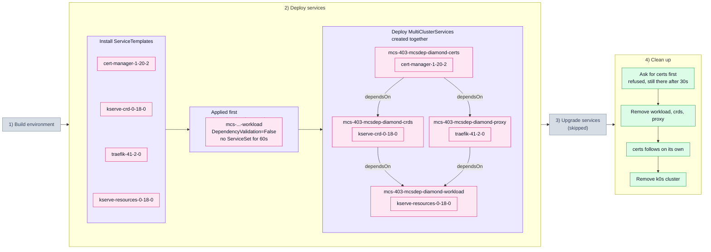

# 4.3. Dependency graph, not a chain (403_mcsdep_diamond)

Four MultiClusterServices: `certs` is depended on by `crds` and `proxy`, and `workload`
depends on both of those. [`401`](401_mcsdep_valid.md) proves a single `dependsOn` edge
is honoured. A single edge cannot show that an MCS waits for *every* dependency rather
than the first to report in, what KCM does while a dependency does not exist at all, or
what it does when one is deleted out from under its dependents. This covers all three.

## Tested steps

1. Install the ServiceTemplates and wait for each to report `valid`.
2. Create `workload` **alone**, before anything it depends on exists.
3. It must report `MultiClusterServiceDependencyValidation=False`, and get no ServiceSet
   for 60s — not a late rollout, none. The window is sat out whatever happens, so a slow
   start cannot pass for a refusal.
4. Create the remaining three in a single apply. Creation order must not be what
   sequences them, only `spec.dependsOn`.
5. Record when each MCS first gets a ServiceSet and when it first reports every service
   deployed.
6. `crds` and `proxy` must not get their ServiceSets before `certs` reported deployed —
   the fan-out. Neither depends on the other, so nothing orders them between themselves.
7. `workload` must not get its ServiceSet before **both** `crds` and `proxy` reported
   deployed — the fan-in. Each moment is compared against each dependency's, so
   finishing after the faster one is not enough.
8. All four end up deployed: helm releases `deployed` in the child cluster, pods ready.
9. Each MCS reports `ClusterInReadyState` with `1/1` in its message. The count, not only
   the status: a build that reported `0/1` for twenty minutes passed everything this
   suite asserted before these checks existed.
10. Ask for `certs` to be deleted first, out of dependency order. It must report
    `MultiClusterServiceDependencyValidation=False` and still be there 30s later — an
    object part-way through its finalizers looks the same as a held one at any single
    moment.
11. Delete `workload`, `crds` and `proxy`, each waited out to absence.
12. `certs` must now disappear on its own: the delete KCM was holding completes once
    nothing depends on it any more.
13. ServiceSets, helm releases, workloads and ServiceTemplates all gone.

## Why these services

The kserve stack split across the graph, so the ordering is needed and not only
asserted: `kserve-resources` renders a Certificate and a `ClusterStorageContainer`, so
it cannot install before `cert-manager` and the kserve CRDs are really there. A gate that
leaks fails the helm release outright.

`proxy` is the opposite case. Traefik needs nothing from `cert-manager`, so only the MCS
edge holds it back — if the gate were keyed on services rather than on the MCS, this is
the one that would start early.

Step 11 takes `kserve-resources` out before `kserve-crd`, which is the teardown failure
[`201_svcdep.yaml`](201_svcdep.yaml) documents.

## Scenario schema

Defined in [`403_mcsdep_diamond.yaml`](403_mcsdep_diamond.yaml).
