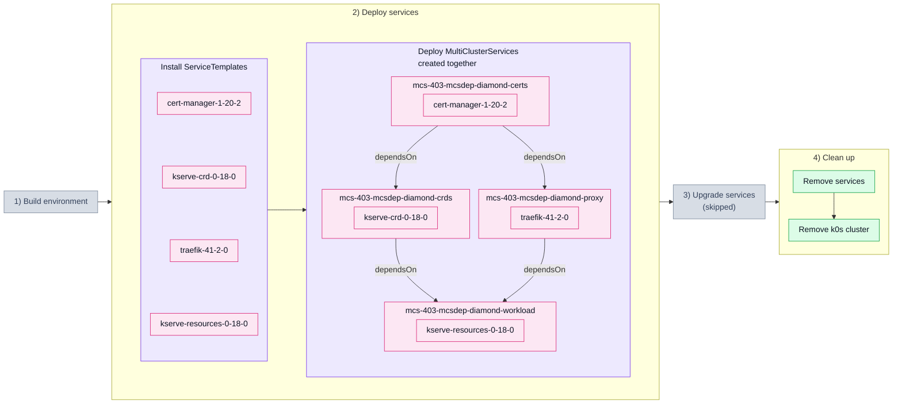

# 4.3. Dependency graph, not a chain (403_mcsdep_diamond)

## Tested steps

1. Install the ServiceTemplates and wait for each to report `valid`.
2. Create all four MultiClusterServices in a single apply — `certs` with `cert-manager`,
   `crds` and `proxy` both with `dependsOn: certs`, and `workload` with
   `dependsOn: [crds, proxy]`. One apply on purpose: creation order must not be what
   sequences them, only `spec.dependsOn`.
3. Record when each MCS first gets a ServiceSet and when it first reports every service
   deployed.
4. `crds` and `proxy` must not get their ServiceSets before `certs` reported deployed —
   the fan-out. Neither of them depends on the other, so nothing orders them between
   themselves.
5. `workload` must not get its ServiceSet before **both** `crds` and `proxy` reported
   deployed — the fan-in, and the thing a single-edge scenario cannot show. Each moment
   is compared against each dependency's, so finishing after the faster one is not
   enough.
6. All four end up deployed: helm releases `deployed` in the child cluster, pods ready.
7. Remove the services: MCSs, ServiceSets, helm releases and workloads all gone.

The services are the kserve stack split across the graph, so a leaking gate does not
merely lose a timing comparison: `kserve-resources` renders a Certificate and a
`ClusterStorageContainer`, and installing it before `cert-manager` and the kserve CRDs
are really there fails the helm release outright. `proxy` is the opposite case — traefik
needs nothing from `cert-manager`, so it is held back by the MCS edge alone.

Teardown runs from the last declared MultiClusterService backwards, which removes
`workload` before `crds`. The other order is the known teardown failure described in
[`201_svcdep.yaml`](201_svcdep.yaml).

## Scenario schema

Defined in [`403_mcsdep_diamond.yaml`](403_mcsdep_diamond.yaml).
